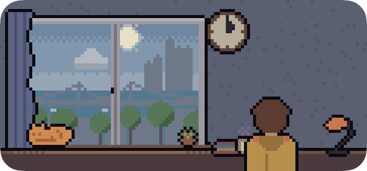
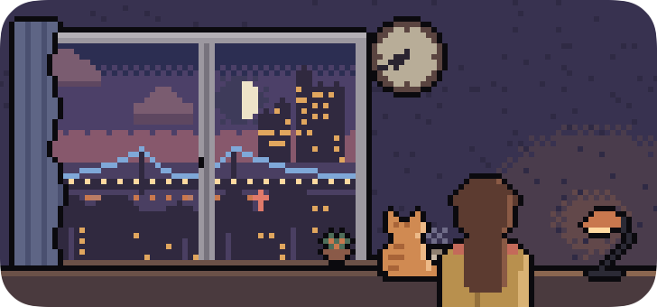

# Christof

[English](README.md) | 한국어

고른 지역의 날씨·시각·명절을 창밖 풍경으로 보여 주는 macOS 위젯입니다. 창문 모양이고, 3pt 도트로 그립니다. 이름은 트루먼 쇼에서 가상 세계를 연출하는 감독 Christof에서 따왔습니다. 이 창문이 가상의 창문이라는 뜻입니다.

| | |
|---|---|
|  |  |
|  |  |

## 보여 주는 것

- **날씨**: 그 지역의 지금 날씨입니다. 맑음, 구름 조금, 흐림, 안개, 이슬비, 비, 눈, 뇌우를 창밖에 그립니다.
- **시각**: 해와 달을 실제 위치에 그리고, 시각에 따라 낮, 해 질 녘, 밤으로 하늘색이 바뀝니다. 벽시계도 그 지역 시각을 가리킵니다.
- **이벤트**
  - 명절·기념일: 설날, 정월대보름, 부처님오신날, 추석, 할로윈, 크리스마스 이브·크리스마스, 새해 첫날
  - 하늘 이벤트: 일출, 일몰, 보름달
  - 이벤트마다 창밖, 옷, 고양이, 방 안 물건, 시계 모양이 바뀝니다.
- **방 안**: 사람과 고양이가 시각에 따라 따로 지내기도 하고, 같이 있거나 같이 밥을 먹기도 합니다. 겨울에는 고양이가 요일마다 다른 색 목도리를 합니다.

위젯에는 글자를 쓰지 않습니다. 지역, 시각, 날씨, 이벤트는 접근성 라벨로 읽어 줍니다. 로그인이나 계정은 없습니다.

지역은 위젯 편집에서 고릅니다.

## 설치 (macOS 26 이상)

터미널에서 실행합니다. 최신 릴리스를 `/Applications` 에 설치하고 앱을 엽니다. 이미 설치돼 있으면 새 버전으로 바꿉니다.

```sh
curl -fsSL https://raw.githubusercontent.com/zzzinho/Christof/main/install.sh | sh
```

특정 버전을 설치하거나 이전 버전으로 되돌리려면 버전을 붙입니다. 버전 목록은 [Releases](https://github.com/zzzinho/Christof/releases)에 있습니다.

```sh
curl -fsSL https://raw.githubusercontent.com/zzzinho/Christof/main/install.sh | sh -s -- v0.1.0
```

설치가 끝나면 바탕화면을 우클릭하고 "위젯 편집"을 고른 뒤, Christof 위젯을 바탕화면에 놓습니다. 앱에서는 위젯 미리보기를 보고 시각·날씨·이벤트를 바꿔 볼 수 있고, 맨 아래에 설치된 버전이 나옵니다.

Apple 공증을 받지 않은 앱입니다. 스크립트로 받으면 그냥 열립니다. 브라우저로 zip 을 받았다면 `xattr -dr com.apple.quarantine /Applications/Christof.app` 을 실행해야 열립니다.

## 삭제

앱과 위젯, 설정을 지웁니다. 바탕화면에 놓인 위젯도 함께 사라집니다.

```sh
curl -fsSL https://raw.githubusercontent.com/zzzinho/Christof/main/uninstall.sh | sh
```

`~/Library/Containers` 의 Christof 폴더는 macOS 가 막아 남을 수 있습니다. 남아도 문제는 없고, 지우려면 Finder 에서 휴지통으로 옮깁니다.

## 디자인

위젯 그림은 HTML 로 디자인하는 로컬 도구 [hunsu](https://github.com/zzzinho/hunsu)로 만들었습니다. 시안(`DESIGN.md`, `design.css`, `*.html`)은 저장소 루트에 있습니다.

## 데이터

날씨는 [Open-Meteo](https://open-meteo.com/)에서 받습니다(CC BY 4.0). 해와 달의 위치는 기기에서 계산합니다.
