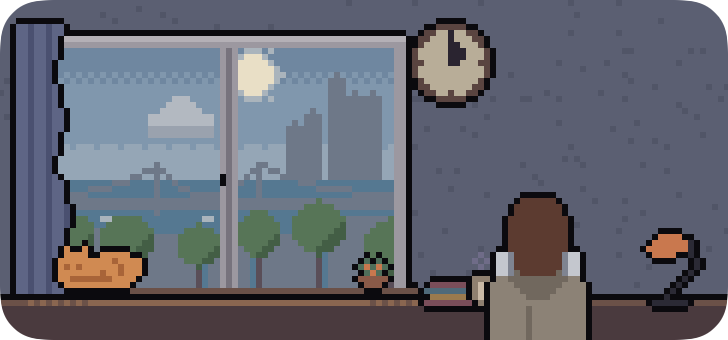
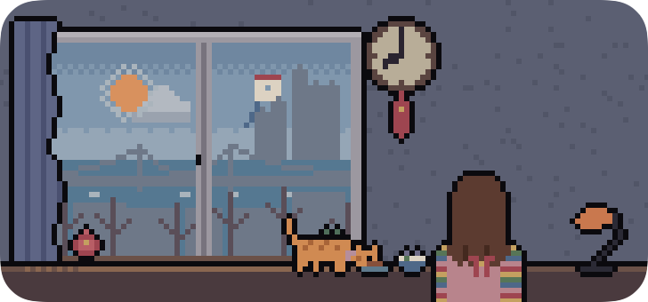
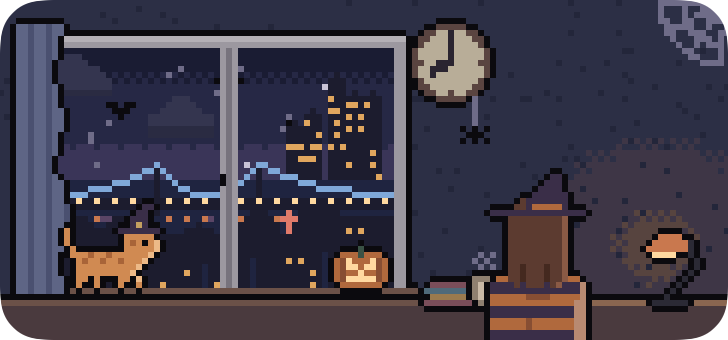
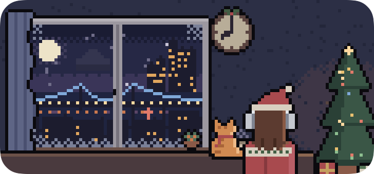

# Christof

English | [한국어](README.ko.md)

A macOS widget that shows the weather, time, and holidays of a place you choose as the view outside a window. It is drawn in 3pt pixel dots. The name comes from Christof, the director who stages the fake world in The Truman Show: this is a virtual window.

| | |
|---|---|
|  |  |
|  |  |

## What it shows

- **Weather**: the current weather of the place. Clear, partly cloudy, overcast, fog, drizzle, rain, snow, and thunderstorms are drawn outside the window.
- **Time**: the sun and moon are drawn at their real positions, and the sky changes through day, dusk, and night. The wall clock shows the local time.
- **Events**
  - Holidays: Seollal (Lunar New Year), Jeongwol Daeboreum (first full moon), Buddha's Birthday, Chuseok, Halloween, Christmas Eve and Christmas, New Year's Day
  - Sky events: sunrise, sunset, full moon
  - Each event changes the view, the outfit, the cat, the things in the room, and the clock.
- **The room**: depending on the time, the person and the cat spend time apart, stay together, or eat together. In winter the cat wears a scarf of a different color each day of the week.

The widget has no text. VoiceOver reads the place, time, weather, and event. There is no login or account.

To choose the place, right-click the widget and edit it.

## Install (macOS 26 or later)

Run this in Terminal. It installs the latest release into `/Applications` and opens the app. If it is already installed, it is replaced with the new version.

```sh
curl -fsSL https://raw.githubusercontent.com/zzzinho/Christof/main/install.sh | sh
```

To install a specific version or go back to an older one, add the version. Versions are listed in [Releases](https://github.com/zzzinho/Christof/releases).

```sh
curl -fsSL https://raw.githubusercontent.com/zzzinho/Christof/main/install.sh | sh -s -- v0.1.0
```

When it finishes, right-click the desktop, choose "Edit Widgets", and place the Christof widget on the desktop. The app shows a preview of the widget where you can try other times, weather, and events, and the installed version is at the bottom.

The app is not notarized by Apple. Installed with the script, it opens normally. If you downloaded the zip in a browser, run `xattr -dr com.apple.quarantine /Applications/Christof.app` before opening it.

## Uninstall

Removes the app, the widget, and the settings. Widgets on the desktop are removed too.

```sh
curl -fsSL https://raw.githubusercontent.com/zzzinho/Christof/main/uninstall.sh | sh
```

macOS may keep the Christof folders in `~/Library/Containers`. They do no harm; to remove them, move them to the Trash in Finder.

## Design

The look of the widget was designed with [hunsu](https://github.com/zzzinho/hunsu), a local tool for designing in HTML. The design files are in [`design/`](design/).

## Data

Weather comes from [Open-Meteo](https://open-meteo.com/) (CC BY 4.0). Sun and moon positions are calculated on the device.
